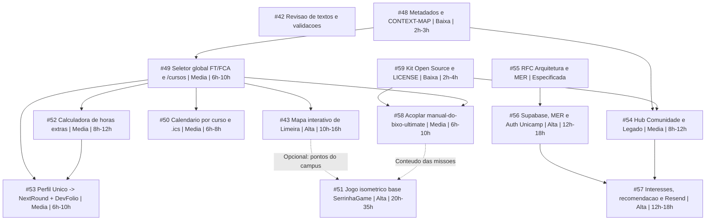

# Backlog, Fluxo de Dependencias e Estimativas

Este documento consolida as issues do Kanban **Guia Unicamp Limeira**, organizadas por epico, com dependencias, complexidade e estimativa de esforco liquido.

---

## 1. Diagrama de Dependencias

---

## 2. Backlog Detalhado por Epico

### Epico #60: Plataforma, Auth Unicamp, Recomendacao e Open Source
| Issue | Tarefa | Complexidade | Esforco Liquido | Depende de |
|---|---|---|---|---|
| **#48** | Atualizar metadados e `CONTEXT-MAP.md` para Guia Unicamp Limeira | Baixa | 2h a 3h | Nenhuma |
| **#59** | Kit Open Source com `LICENSE`, `CONTENT-LICENSE.md`, `CONTRIBUTING.md` e `.env.example` | Baixa | 2h a 4h | Nenhuma |
| **#55** | RFC de arquitetura Supabase, Auth Unicamp, Recomendacao, Manual do Bixo e Open Source | Alta | Especificada | Nenhuma |
| **#56** | Configurar Supabase, migracoes do MER e Auth Google restrito a dominios Unicamp | Alta | 12h a 18h | #55 |
| **#57** | UI de interesses, registro de interacoes, recomendacao e digest semanal com Resend | Alta | 12h a 18h | #56, #54 |
| **#42** | Revisar textos com acentuacao e cedilha e validar mural, estagio e videos | Baixa | 2h a 3h | Nenhuma |

Subtotal do Epico #60: 30h a 46h.

### Epico #44: Dominio Academico e Cursos para FT e FCA
| Issue | Tarefa | Complexidade | Esforco Liquido | Depende de |
|---|---|---|---|---|
| **#49** | Seletor global de curso e campus no `PreferencesProvider` e rotas `/cursos/[slug]` | Media | 6h a 10h | #48 |
| **#50** | Calendario academico interativo filtravel por curso e campus com exportacao `.ics` | Media | 6h a 8h | #49 |
| **#58** | Acoplar `otbox/manual-do-bixo-ultimate` em `/calouros` | Media | 6h a 10h | #49, #59 |

Subtotal do Epico #44: 18h a 28h.

### Epico #45: Dominio Campus e Cidade
| Issue | Tarefa | Complexidade | Esforco Liquido | Depende de |
|---|---|---|---|---|
| **#43** | Mapa interativo de Limeira com camadas de restaurantes, moradia, campi e transporte | Alta | 10h a 16h | #49 |
| **#51** | Jogo 2D isometrico da calourada adaptado de `MarceloSantosBMDev/SerrinhaGame` com D-pad mobile | Alta | 20h a 35h | #58, #43 |

Subtotal do Epico #45: 30h a 51h.

### Epico #46: Dominio Carreira e Ferramentas
| Issue | Tarefa | Complexidade | Esforco Liquido | Depende de |
|---|---|---|---|---|
| **#52** | Calculadora client-side de horas extracurriculares, extensao e estagio | Media | 8h a 12h | #49 |
| **#53** | Perfil Unico de Carreira gerando CV via NextRound e Portfolio via DevFolio | Media | 6h a 10h | #49, #52 |

Subtotal do Epico #46: 14h a 22h.

### Epico #47: Dominio Comunidade e Legado
| Issue | Tarefa | Complexidade | Esforco Liquido | Depende de |
|---|---|---|---|---|
| **#54** | Hub `/comunidade` com Open Source, Hall da Fama, Historico de Gestoes e Produtos | Media | 8h a 12h | #48, #59 |

Subtotal do Epico #47: 8h a 12h.

---

## 3. Resumo de Prazo Total e Caminho Critico

- **Esforco total estimado nas 13 issues tecnicas:** 100h a 159h liquidas.
- **Caminho critico:** #48 -> #49 -> #56 -> #57, totalizando cerca de 41h no trilho principal de plataforma, enquanto o jogo na #51 corre em paralelo.
- **Prazo projetado:** 10 a 15 semanas para execucao individual em tempo parcial, ou 3 a 5 semanas paralelizando por nucleos com agentes de IA e voluntarios.
