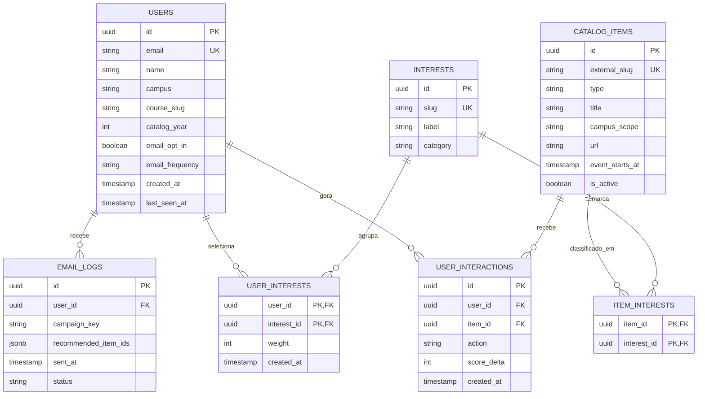

# RFC-02: Plataforma Guia Unicamp Limeira

**Status:** Proposta  
**Data:** 2026-11-23  
**Issue:** #55  
**Contexto:** Evolucao do guia-sobrevivencia-ft para guia-unicamp-limeira, abrangendo FT, FCA e a cidade de Limeira.

---

## 1. Diagnostico da base atual

O projeto atual na branch dev possui uma base consolidada em Next.js 15 com App Router, React 19, TypeScript e Sass:

- **Rotas implementadas:** pagina inicial com quiz de boas-vindas e perfis de audiencia, alem de `/academico`, `/calouros`, `/campus`, `/carreira`, `/duvidas`, `/estatisticas`, `/estudos-ia`, `/links` e `/versoes`.
- **Modulos de dominio e estado:** `src/modules/preferences`, contendo `PreferencesProvider`, `useStudentProfile` e `useJourneyStage`, centraliza preferencias em `localStorage`. O modulo `src/sectionCoordinator` e `src/data/*` mantem os catalogos estaticos.
- **APIs existentes em `src/app/api/`:** `cron`, `duvidas`, `estatisticas`, `mural`, `pesquisa` e `telemetry`.
- **Lacunas para os novos requisitos:** ausencia de autenticacao para usuarios Unicamp, ausencia de banco relacional e MER para preferencias e historico, ausencia de motor de recomendacao e disparo de e-mails, alem da falta de arquivo `LICENSE` e guia formal de contribuicao open source.

---

## 2. Requisitos e Regras de Negocio

1. **Zero friccao para calouros e visitantes:** calouros sem e-mail institucional nao se cadastram nem fazem login. Toda a experiencia funciona via `localStorage` pelo `PreferencesProvider`.
2. **Conta Unicamp por opt-in:** quem possui e-mail institucional nos dominios `@dac.unicamp.br`, `@g.unicamp.br`, `@unicamp.br`, `@ft.unicamp.br` ou `@fca.unicamp.br` pode autenticar com Google OAuth. No primeiro login, o estado local e migrado para o banco.
3. **Interesses, historico e personalizacao:** usuarios autenticados selecionam interesses e acumulam historico de interacoes, como visualizacao, curtida, salvamento, confirmacao de presenca e conclusao. Esses sinais reordenam produtos da comunidade e eventos nas paginas e alimentam e-mails segmentados com consentimento LGPD.
4. **Acoplamento com `otbox/manual-do-bixo-ultimate`:** a rota `/calouros` passa a consumir e exibir os capitulos do projeto `otbox/manual-do-bixo-ultimate`.
5. **Projeto Open Source:** separacao estrita entre dados publicos comunitarios versionados no Git e dados privados ou PII isolados no banco em producao.

---

## 3. Modelo Entidade-Relacionamento

---

## 4. Arquitetura de Backend

- **Stack escolhida:** Next.js App Router Route Handlers em `src/app/api/*` combinado com **Supabase**, incluindo PostgreSQL, Auth e Row Level Security. As regras de negocio permanecem isoladas em `src/modules/` conforme a ADR 0011, permitindo extracao futura para NestJS caso surjam workloads pesados.
- **Auth Unicamp:** Google OAuth no Supabase com parametro `hd` e validacao estrita de dominio no banco via trigger em `auth.users`.
- **E-mails:** Resend com React Email disparado por Vercel Cron semanal em `/api/cron/digest`, respeitando `email_opt_in` e link de descadastro em um clique.
- **Endpoints principais:**
  - `GET` e `PATCH /api/me/preferences`: le e atualiza curso, campus, opt-in e interesses.
  - `POST /api/me/sync`: mescla o estado inicial do `localStorage` no primeiro login.
  - `POST /api/interactions`: registra `view`, `like`, `bookmark`, `rsvp` ou `complete`.
  - `GET /api/recommendations`: retorna ranking personalizado para autenticados ou filtrado por campus e curso para visitantes.
  - `POST /api/cron/digest`: gera e dispara o digest semanal.

---

## 5. Arquitetura de Frontend

- O `PreferencesProvider` em `src/modules/preferences` mantem a fachada unica com `useStudentProfile` e `useJourneyStage`, alternando entre adaptador `localStorage` para calouros e adaptador Supabase para usuarios autenticados.
- Inclusao de botao discreto para entrada com e-mail Unicamp no cabecalho e no perfil, onboarding de interesses por chips e blocos de recomendacao para produtos da comunidade e eventos.

---

## 6. Acoplamento com `otbox/manual-do-bixo-ultimate`

1. **Fase 1:** sincronizar `capitulos/*.md` do repositorio `otbox/manual-do-bixo-ultimate` na rota `/calouros`, preservando creditos aos autores e conformidade WCAG AA.
2. **Fase 2:** acoplar a versao HQ folheavel em Astro na subrota `/calouros/hq` via Vercel rewrite ou embed, mediante alinhamento previo de licenca com o mantenedor original.

---

## 7. Governanca Open Source e LGPD

- Adocao da licenca **MIT** para codigo-fonte e **CC BY-SA 4.0** para textos editoriais.
- Dados comunitarios publicos permanecem versionados no Git via Pull Request; dados pessoais e logs de interacao ficam isolados no PostgreSQL com RLS e `.env.example` documentado.
